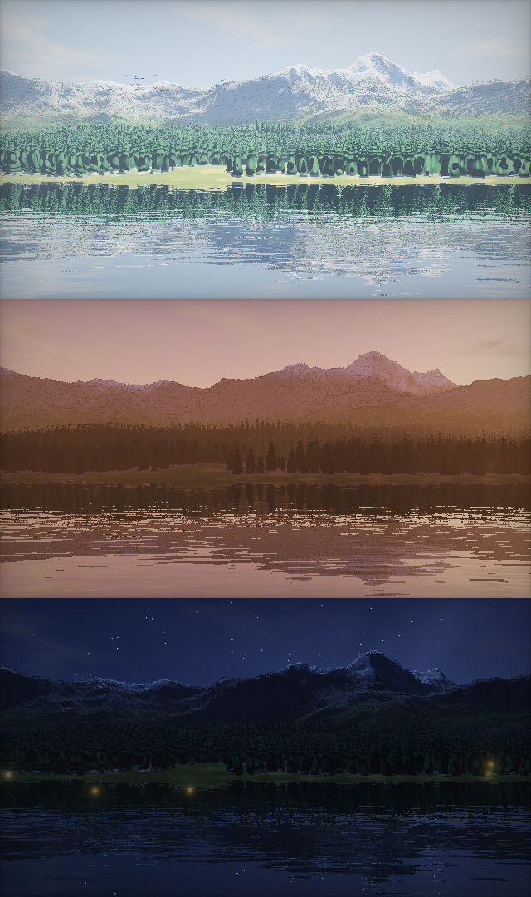
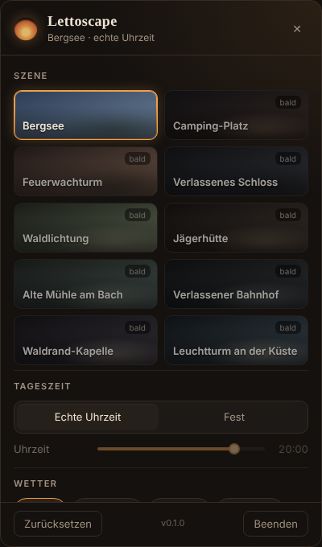

# 🔥 Lettoscape

Cozy, immersive Live-Wallpaper für Windows (Linux folgt).
Echte Tag/Nacht-Zeit, Wetter, Nebel, Sterne, Glühwürmchen, Ambient-Sound, alles im Panel einstellbar.

<p> </p>

## Features

- **Live-Wallpaper** hinter den Desktop-Icons (Windows 10/11, inkl. 24H2)
- **Tray-Icon** unten in der Taskleiste: Klick öffnet das Einstellungs-Panel
- **Autostart** mit Windows
- **Tag/Nacht** nach echter Uhrzeit oder fest eingestellt
- **Wetter**: Klar, Bewölkt, Regen, Schnee, Nebel (weiche Übergänge)
- **Ambient-Sound**: Wind, Wasser, Regen, Grillen in der Nacht (prozedural, keine Dateien)
- **Maus-Parallax**, mehrere Bildschirme
- **Pausiert automatisch**, wenn ein Spiel/Video im Vollbild läuft
- Leistung einstellbar: FPS, Auflösung, Qualität

## Szenen

| Szene | Status |
|---|---|
| Bergsee | ✅ |
| Camping-Platz | 🔜 |
| Feuerwachturm | 🔜 |
| Verlassenes Schloss | 🔜 |
| Waldlichtung | 🔜 |
| Jägerhütte | 🔜 |
| Alte Mühle am Bach | 🔜 |
| Verlassener Bahnhof | 🔜 |
| Waldrand-Kapelle | 🔜 |
| Leuchtturm an der Küste | 🔜 |

## Starten (Entwicklung)

Voraussetzung: [Node.js](https://nodejs.org) 20 oder neuer.

```bash
npm install
npm start
```

## Installer bauen (Windows)

```bash
npm run dist:win
```

Der Installer landet in `dist/`.

## Projektstruktur

```
src/
  main/        Hauptprozess: Tray, Panel, Autostart, Desktop-Einbindung
  wallpaper/   Renderer (WebGL2) + Szenen-Shader + Sound
  panel/       Einstellungs-Panel
  shared/      Standard-Einstellungen + Szenenliste
assets/        Icons
```

## Neue Szene hinzufügen

1. Shader in `src/wallpaper/scenes/<name>.js` anlegen (Vorlage: `bergsee.js`)
2. In `src/wallpaper/scenes/index.js` eintragen
3. In `src/shared/scenes.json` auf `"ready": true` setzen

## Lizenz

MIT
